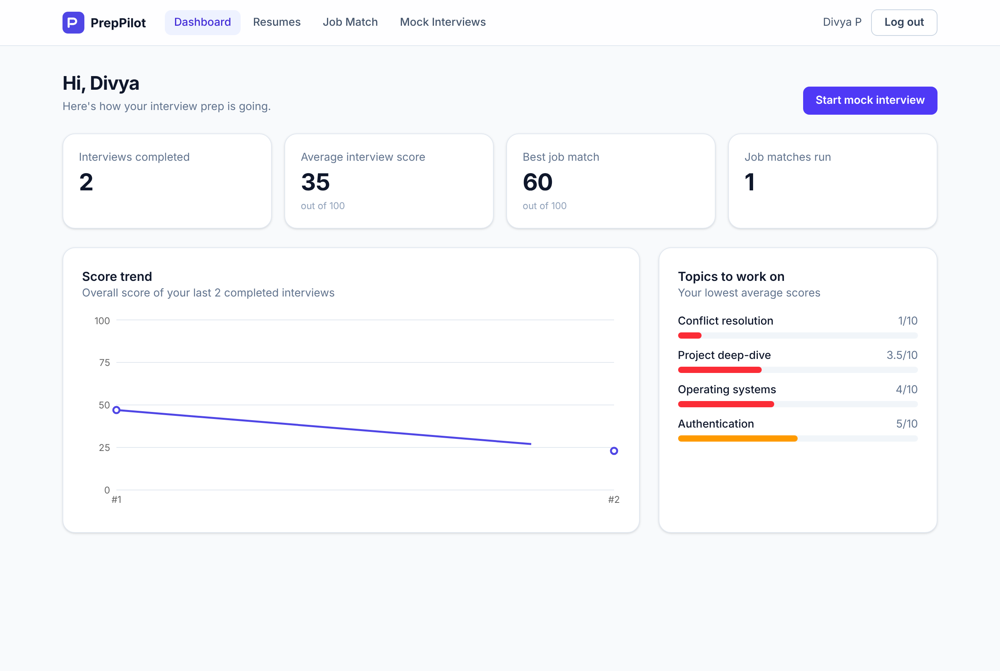
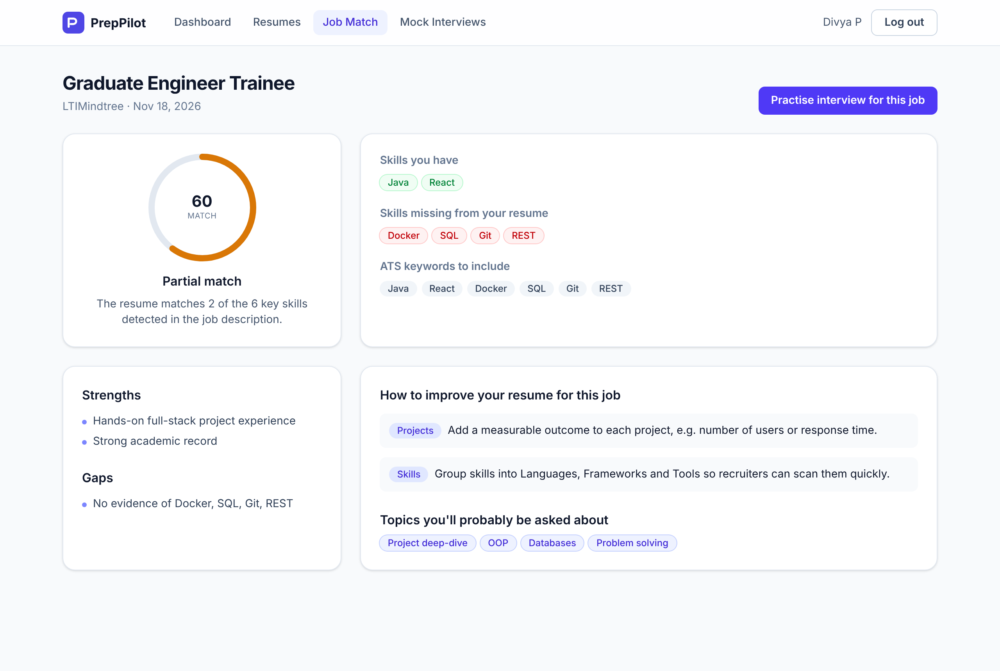
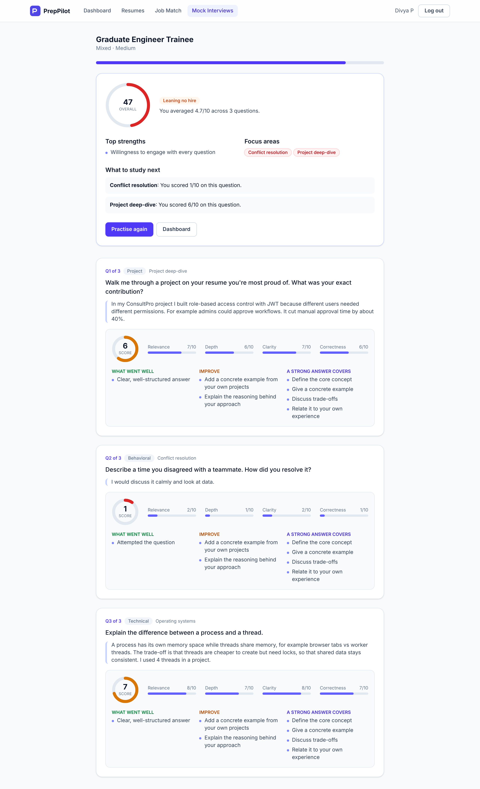

# PrepPilot: AI Interview Prep Platform

PrepPilot helps students and early-career engineers get ready for placement interviews. Upload a resume, see how well it matches a job description, then practise with an AI interviewer. The interviewer reads your resume, adapts each question to your previous answers, and scores every answer against a rubric.



## Features

- **Resume parsing.** Upload a PDF. Claude reads it directly (no OCR step) and turns it into a structured profile: skills, projects, experience and education.
- **Job match analysis.** Paste any job description to get a 0–100 match score, matched and missing skills, ATS keywords, and specific edits to make to the resume.
- **Adaptive mock interviews.** Choose technical, HR or mixed, at easy, medium or hard. Each question is based on your resume and on how you answered the previous one: a weak answer gets a follow-up probe, a strong one moves the interview to a new topic.
- **Rubric-based feedback.** Every answer is scored on relevance, depth, clarity and correctness. Feedback lists what went well, what to improve, and what a strong answer would cover.
- **Final report.** You get an overall score, a hire signal, focus areas and the topics to study next.
- **Voice mode.** You can speak your answers (browser speech recognition) and have questions read aloud.
- **Progress dashboard.** Shows your score trend across interviews and your weakest topics, based on per-topic averages.

| Job match | Interview feedback |
|---|---|
|  |  |

## Architecture

```
React + Vite + Tailwind  ──/api──►  Express (TypeScript)  ──►  PostgreSQL
  (nginx in production)               │
                                      ├─ JWT auth, rate limiting, Zod validation
                                      └─ AIProvider interface
                                           ├─ ClaudeProvider (Anthropic SDK, structured outputs)
                                           └─ MockProvider   (deterministic; offline demos and tests)
```

### Design decisions

- **Structured outputs, validated twice.** Every AI call is constrained to a JSON schema generated from a Zod schema, and the response is parsed with Zod again before it is used. Scores are clamped server-side. The UI never shows unvalidated model text.
- **One call per interview turn.** Evaluating an answer and generating the next question happen in a single request, which halves latency per turn compared with two calls.
- **Prompt caching.** The interview context (resume and job description) goes in its own cached block, because it is identical on every turn of an interview.
- **Provider abstraction.** `AIProvider` is an interface. A deterministic `MockProvider` lets the whole app run, and the integration tests pass, without an API key or network access.
- **Graceful failure.** Refusals, truncated output, rate limits and provider outages map to clear HTTP errors. Requests use server-side model fallback when a request is declined.
- **Race-safe answers.** Submitting an answer uses `UPDATE … WHERE answer IS NULL`, so a double submit can't record two answers or create two follow-up questions.
- **Cost control.** AI endpoints are rate-limited per user. Uploads are capped at 5 MB and checked for PDF magic bytes, not just the MIME type the browser reports.

### Data model

`users` → `resumes` → `analyses`
`users` → `interviews` → `interview_turns` (question, answer, score, rubric evaluation as JSONB)

## Tech stack

**Frontend:** React 19, TypeScript, Vite, Tailwind CSS v4, React Router, Recharts, Web Speech API
**Backend:** Node.js 22, Express 5, TypeScript, PostgreSQL 16, Zod, JWT, bcrypt, Multer
**AI:** Anthropic Claude API (structured outputs, PDF input, prompt caching)
**Quality:** Vitest and Supertest integration tests against real Postgres, GitHub Actions CI, Docker multi-stage builds

## Running locally

### Option A: Docker (simplest)

```bash
cp server/.env.example .env               # optional: add ANTHROPIC_API_KEY
docker compose up --build                 # open http://localhost:8080
```

No API key? Run `AI_MOCK=true docker compose up --build` to try the app with realistic canned AI responses.

### Option B: Dev servers

Requires Node 22+ and PostgreSQL 16.

```bash
createdb preppilot
cd server && cp .env.example .env && npm install && npm run dev     # API on :4000
cd client && npm install && npm run dev                              # UI on :5173
```

The database schema is applied automatically on startup.

## Deploying (Render)

`render.yaml` is a Render Blueprint. It creates one web service (the API also serves the built React app) and a PostgreSQL database. In the Render dashboard, choose **New → Blueprint**, pick this repository and click **Apply**. The site starts in demo mode. To use real AI, set `AI_MOCK=false` and add `ANTHROPIC_API_KEY` under the service's Environment settings.

## Tests

```bash
createdb preppilot_test
cd server && npm test
```

The integration tests cover auth (including case-insensitive duplicate emails), PDF validation, the full resume → match → interview → report flow, ending an interview early, double-submit protection, data isolation between users, and the dashboard statistics.

## Roadmap

- [ ] Live coding round with sandboxed code execution
- [ ] Company-specific question bank with retrieval (RAG)
- [ ] Streaming responses so feedback appears as it is generated
- [ ] Shareable interview reports
